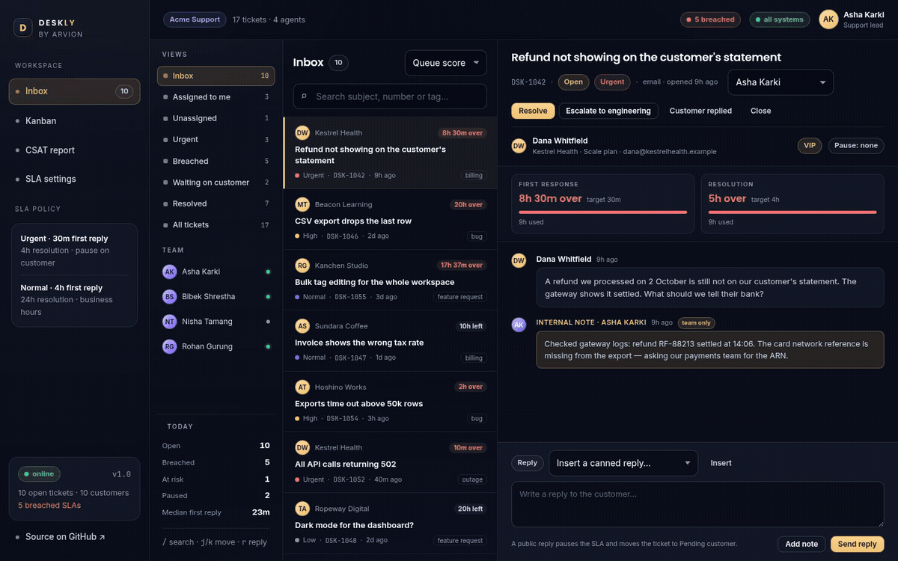
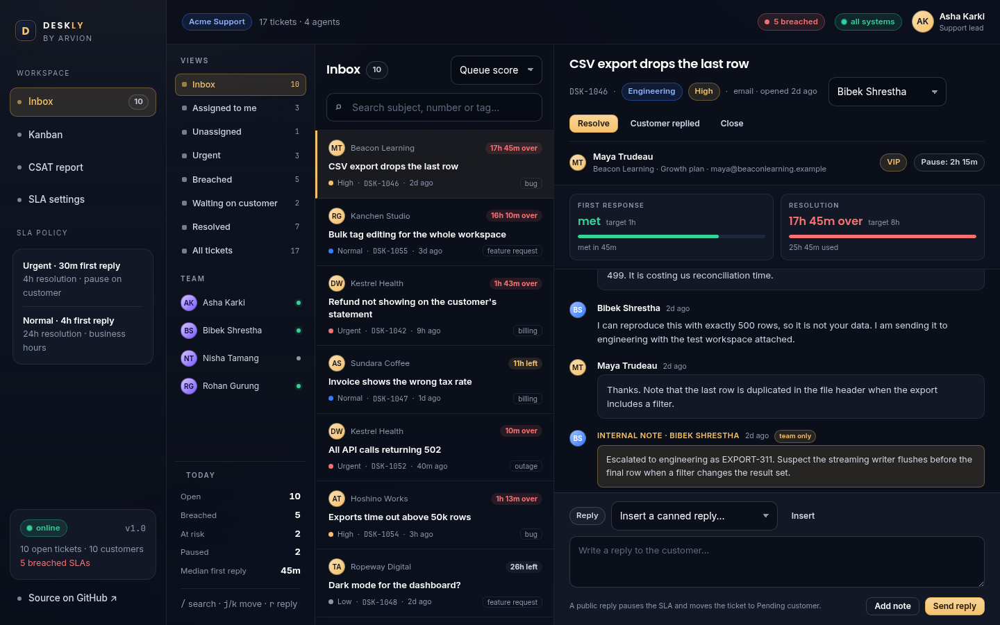
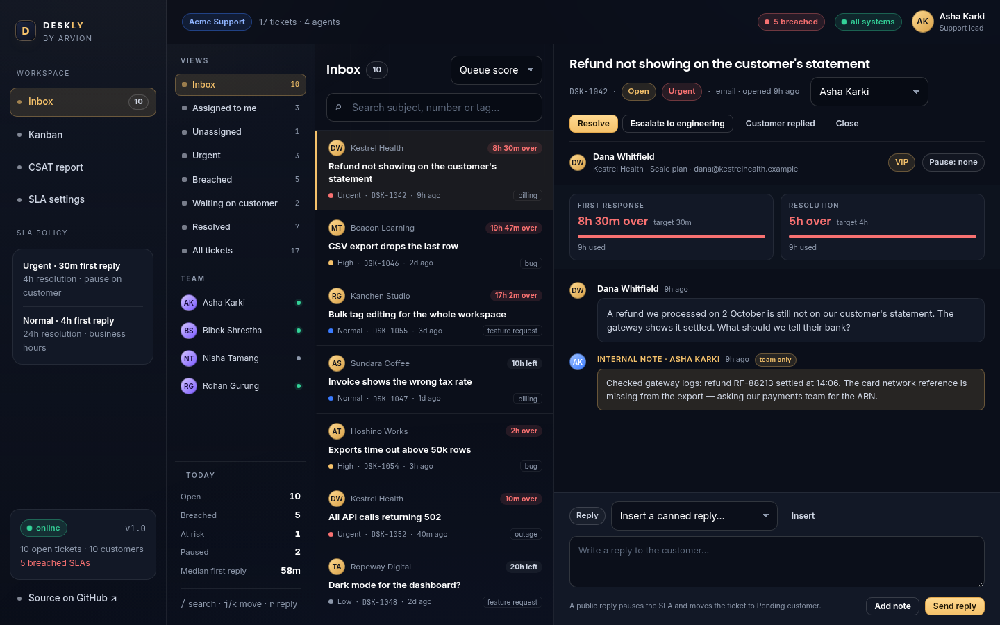

<div align="center">

</div>

<sub>Recorded from the live demo — <a href="docs/demo.mp4">MP4</a> · <a href="docs/screenshot.png">static frame</a></sub>

# Deskly

A support desk in the browser: a three-pane inbox, a ticket state machine, SLA countdowns in business minutes, a kanban board and a CSAT report. No dependencies and no build step — the whole app is static files plus a small framework-free engine in `src/`.

[**Open the live demo**](https://arvion-technology.github.io/labs/demos/deskly/) · [MIT](LICENSE)

---

The demo seeds seventeen tickets for ten fictional customers and four agents, including a breached urgent ticket, an unassigned security report, a reply that paused its clock, and a pending-engineering escalation. The timestamps are relative to the moment you open the page, so the countdowns are live. Replies and status changes you make stay in `localStorage`.

## What it does

- **Inbox** — saved views with counts (Assigned to me, Unassigned, Urgent, Breached, Paused, Resolved), queue-score sorting, search and `j`/`k` navigation.
- **Conversation** — the full customer timeline with internal notes marked as team-only, a canned-reply picker, public replies and notes.
- **SLA panel** — first-response and resolution countdowns, each with the target, elapsed business time, progress and the pause total.
- **Kanban** — the same tickets grouped by state; columns follow the state machine rather than an arbitrary list.
- **CSAT report** — average, response rate, satisfaction split, weekly trend, per-agent table and the comments worth reading.
- **Settings** — the policy table, the business calendar and holidays, straight from the same engine the inbox uses.

## Screenshots

| Three-pane inbox | Kanban board |
| --- | --- |
|  |  |

## Architecture

```text
demo/index.html + app.js          three-pane inbox, kanban, reports
   │  imports
   ├── src/model.js               priorities, states, policies, reply/resolution facts
   ├── src/sla.js                 business calendar, pause reconstruction, SLA evaluation
   ├── src/tickets.js             state machine, queue rank, saved views, kanban grouping
   ├── src/csat.js                response rate, distributions, per-agent, weekly trend
   └── src/sample.js              seeded workspace: 17 tickets, 10 customers, 4 agents
test/*.test.js                    35 node:test cases
```

The inbox, the kanban board and the CSAT report all read the same ticket objects. Nothing is precomputed into the sample data except the messages and history: every SLA state, countdown, queue position and satisfaction number is calculated at render time.

## Quickstart

```bash
git clone https://github.com/arvion-technology/deskly.git
cd deskly
npm test          # 35 tests, no dependencies, Node 20+
npm run demo      # http://localhost:4173
```

`package.json` exists so `npm test` and CI have a standard entry point. There is nothing to install.

## How it works

**The clock counts business minutes, not wall-clock minutes.** `businessMinutesBetween(start, end, calendar)` walks the days between two instants, intersects each day with the support windows, and skips weekends and holidays. At 17:50 on Friday, an urgent ticket with a 30-minute first-response target has 10 minutes left today; the other 20 minutes are consumed from 08:00 on Monday, so the real deadline is 08:20 Monday. That is the only model in which an after-hours queue is honest — a wall-clock timer punishes agents for not working on Sunday.

`addBusinessMinutes(start, minutes, calendar)` runs the same walk in the other direction and returns an actual deadline instant. Both functions are pure and take the calendar as an argument, so the tests can define a two-window day with a lunch break or a one-week holiday and get exact answers.

**Pausing is reconstructed, not stored twice.** The ticket's `history` is the source of truth. Every entry into `pending_customer` opens a pause window; the next non-pause status closes it; an open window at `now` is still running. `activeBusinessMinutes()` subtracts the business minutes inside those windows from the total. That is why a reply can pause a 4-hour resolution target with 35 minutes used and keep showing 35 minutes used until the customer answers. If a paused ticket is resolved by an outbound follow-up, the pause closes and the clock resumes for the remainder. Storing a `pausedSeconds` counter instead would drift the first time an edit or an import rewrote history.

**Status is a state table.** `TRANSITIONS` maps state → event → next state. A public reply moves `open` to `pending_customer`; resolving closes the clock; a customer reply reopens it; a closed ticket cannot receive a reply until it is reopened. The UI does not check legality separately — it calls `canTransition()` to show the buttons and `transition()` to apply them, and an illegal move throws. That is why the reply box is disabled on a resolved ticket instead of quietly accepting a message.

**Queue order is explicit.** `priorityScore` is priority rank × 100 + waiting business minutes (capped at 480) + 200 for a breach + 60 for being close + 30 when the customer is waiting on us + 40 for a VIP. Every weight is a named constant; there is no opaque sort. Breached tickets therefore rise above healthy ones, and a three-day-old normal ticket can outrank a fresh high one — which is usually the behaviour a support lead wants.

**CSAT is reported with its denominator.** Only resolved or closed tickets are eligible, and only those with a survey response count toward the average. `csatSummary` returns `responses`, `eligible` and `rate` next to the average, because "4.8 from six replies out of 300 tickets" is not a 4.8-star desk. Weeks without a response are `null` in the trend and are omitted from the line chart rather than plotted as zero.

## Tests

```bash
npm test
```

35 tests on `node:test`:

- `test/sla.test.js` — calendar validation, partial days and lunch breaks, weekend and holiday skipping, forward and backward business-minute arithmetic, pause reconstruction, breach and warning boundaries, stopped clocks, custom policies and duration labels.
- `test/tickets.test.js` — every legal transition plus refused ones, history ordering, message validation, priority scoring weights, queue ordering, all saved views, free-text search, kanban grouping and queue counts.
- `test/csat.test.js` — empty surveys returning `null` rather than zero, response rates, distributions, per-agent averages, weekly bucketing and low-score-first comments, plus an integrity test over the seeded workspace.

The demo also ships a static check:

```bash
node scripts/serve-check.mjs
```

## Limitations

- The business calendar uses one fixed UTC offset per workspace (Nepal, UTC+05:45, has no DST), not IANA zones with DST rules. For a team whose support hours cross a DST boundary, pass a zone-aware calendar; the SLA module takes the calendar as a parameter for exactly that reason.
- This is a local-first demo, not a mail client. There is no inbox ingestion, no outbound email, no authentication and no multi-tenancy; replies are recorded in memory/localStorage only.
- The kanban board is a view, not a drag-and-drop editor. Moving a card is done from the ticket's status actions so every move goes through the state machine; drag-and-drop was left out rather than adding a second, weaker transition path.
- Saved views are code (`SAVED_VIEWS`), not user-created filters. Real products let leads build views; this demo keeps the set fixed so the counts stay explainable.
- CSAT is collected from seeded responses. There is no survey email or public form, and no way for a customer to rate the demo ticket you just handled.
- The sample data is fictional. Customer names, companies and ticket text exist only to exercise the engine; no metric on screen came from a real support team.

## Project layout

```text
deskly/
├── demo/
│   ├── index.html        three-pane inbox, kanban and report shells
│   ├── app.js            rendering, routing, reply and action wiring
│   ├── arvion.css        shared Arvion design system
│   ├── styles.css        inbox, kanban and CSAT layout
│   └── arvion.js         charts, tables, formatting, storage helpers
├── src/
│   ├── model.js          states, priorities, policies and shared facts
│   ├── sla.js            business calendar and SLA evaluation
│   ├── tickets.js        state machine, queue rank, saved views
│   ├── csat.js           satisfaction summaries and trend
│   └── sample.js         seeded workspace
├── test/                 35 node:test cases
├── scripts/              serve, screenshot, static check
└── .github/workflows/    tests on Node 20 and 22
```

## Credits

Built by [Arvion Technologies](https://arviontech.net) in Kathmandu as part of our open-source [Labs](https://github.com/arvion-technology/labs) series. MIT licensed.
